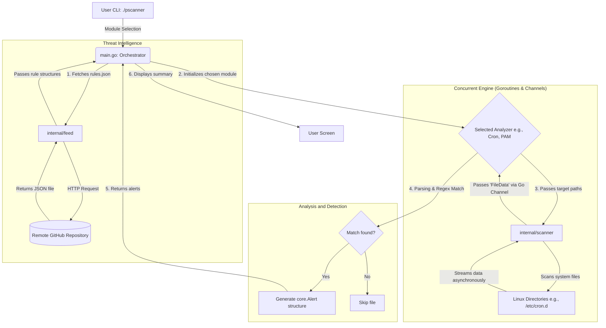

# Linux Persistence Scanner

[](https://go.dev/)
[]()
[](LICENSE)

## TL;DR

Modular, Go-based Blue Team utility designed to hunt for backdoors, rootkits, and persistence mechanisms across Linux environments. 

Instead of relying on easily bypassed basic string matching, it uses a centralized, dynamic JSON Threat Intelligence feed and a pre-compiled Regular Expression engine. This allows it to effectively catch common attacker obfuscation techniques, such as hidden memory execution, absolute path overrides, and whitespace manipulation.

* **Core Tech:** Go (Golang)
* **Current Targets:** `/etc/systemd/`, `/etc/cron.*`, `/var/spool/cron/`, `/etc/pam.d/`, `/etc/update-motd.d/`, `/etc/udev/rules.d/`* 
* **Key Advantage:** Plug-and-play architecture allowing seamless integration of new detection modules.

## Overview

The scanner utilizes a decoupled, rule-driven architecture. Detection logic is completely separated from the core scanning engine by fetching external rules from a remote JSON feed (`rules.json`) and enforcing validation using robust regular expressions (Regex). This design ensures that the tool can rapidly adapt to new threats without requiring recompilation of the core engine.

## Architecture & Data Flow

The project is structured around modular Go design patterns, emphasizing a clear Separation of Concerns. The core engine does not hardcode analysis logic; instead, it relies on pluggable modules that implement a universal `Analyzer` interface.

The flowchart below illustrates the data flow within the application, from startup to alert generation:



## Core Components

### 1. Central Orchestration & CLI (`main.go`)

* **Interactive Interface**: Provides a clean command-line interface allowing the security analyst to select specific attack vectors for scanning.
* **Module Registry**: Acts as the central hub that registers available `Analyzer` implementations and routes the execution flow based on user input.
* **Process Coordination**: Synchronizes the workflow between fetching the rules, initializing the concurrent directory scanner, and delegating the payload analysis to the selected module.

### 2. Concurrent Directory Scanner (`scanner/`)

* Built using Go routines and channels (`chan core.FileData`).
* Efficiently traverses deep directory structures, streaming file paths and their raw contents asynchronously to minimize memory footprints and execution overhead.

### 3. Threat Intelligence Feed (`internal/feed`)

* **Dynamic Updates**: Fetches the central `rules.json` upon startup, ensuring the scanner is always armed with the latest Threat Intelligence.
* **Decoupled Rules**: Separates rule definitions from the codebase, parsing and mapping them into standardized Go structures for the analysis modules to consume.

### 4. Advanced Pattern Matching (Module Level)

* **Regex-Powered Detection**: Analysis modules do not rely on basic substring matching. They evaluate configurations and scripts against pre-compiled regular expressions (`regexp.MatchString`) provided by the JSON feed.
* **Bypass Mitigation**: The combination of data normalization during the parsing phase (e.g., using `strings.Fields`) and robust Regex patterns (e.g., `\s+`) successfully thwarts obfuscation techniques like multiple spaces, tabs, and absolute binary path overrides (e.g., detecting `/usr/bin/nc` exactly like `nc`).

## Built-in Analysis Modules

The scanner is an open platform designed to easily integrate new attack vectors. The current release comes pre-packaged with baseline analyzers targeting the most common Linux backdoor locations:

* **Cron Persistence (`cron`)**: Analyzes system crontabs, user spools, and periodic execution directories (`cron.daily`, etc.) for unauthorized background tasks, `@reboot` directives, and environment variable injections (e.g., `LD_PRELOAD`).
* **Pluggable Authentication Modules (`pam`)**: Inspects `/etc/pam.d/` configurations to detect authentication bypass backdoors (e.g., `auth sufficient pam_permit.so`) and malicious external command hooks.
* **Systemd Services (`systemd`)**: Scans service unit files across the system for embedded reverse shells, interactive interpreters, and unauthorized payload executions in directives.
* **MOTD Files (`motd`)**: Monitors dynamic Message of the Day scripts for unauthorized command execution and hidden network activity triggered upon user login.
* **Udev Device Manager (`udev`)**:  Analyzes device rules to detect unauthorized executions triggered by hardware events and environment variable (`ENV`) evasion attempts.

*(Additional modules are actively being developed and can be seamlessly integrated into the central `Analyzer` registry).*

## ⚠️ Disclaimer & Ongoing Development

Scanner is actively being developed and updated. While current modules effectively detect standard persistence techniques and common obfuscation patterns, they may not cover every advanced obfuscation method. Parsing logic and detection rules are continuously being refined and expanded.

**Note on False Positives (FPs):** Because the tool relies on regex-based analysis of system configurations, False Positives (FPs) may occasionally occur. Highly customized administrative scripts or legitimate system updates might use structures that overlap with `LOW` and `MEDIUM` severity threat signatures. Analysts are always advised to manually verify the context of flagged alerts.

## Installation & Execution

1. **Clone the Repository**:
   ```bash
   git clone https://github.com/JakubMalisz/PersistenceScanner.git
   cd PersistenceScanner
   ```

2. **Build the Binary**:
   ```bash
   go build -o pscanner main.go
   ```

3. **Execution**:
   The scanner requires administrative privileges to read restricted system files and configuration directories:
   ```bash
   sudo ./pscanner
   ```

## Alert Structure

When a threat is identified, the engine constructs a standardized `core.Alert` structure, regardless of which module triggered it:

* **FilePath**: Absolute path to the compromised configuration file or script.
* **Pattern**: The specific IoC that triggered the match.
* **Description**: Human-readable explanation of the threat vector.
* **Severity**: Risk classification (`LOW`, `MEDIUM`, `HIGH`, `CRITICAL`).
* **ExtraInfo**: Module-specific contextual metadata (e.g., Cron schedules, target users).

## Testing & Proof of Concept (PoC)

To verify the detection capabilities of each module against various persistence and evasion vectors, refer to the [TESTING.md](TESTING.md) document.

## Acknowledgments & Sources (Pattern Authors): 
The database was generated and optimized based on public infosec community research and recognized open-source projects. Malicious behavior signatures draw directly from:

- MITRE ATT&CK® Framework

- GTFOBins (Emilio Pinna, Andrea Cardaci, and the community) – patterns for abusing native Unix/Linux binaries.

- PentestMonkey – original interactive shell vectors (Reverse Shell Cheatsheet).

- PayloadsAllTheThings (SwisskyRepo) – advanced defense evasion techniques and one-liners.
